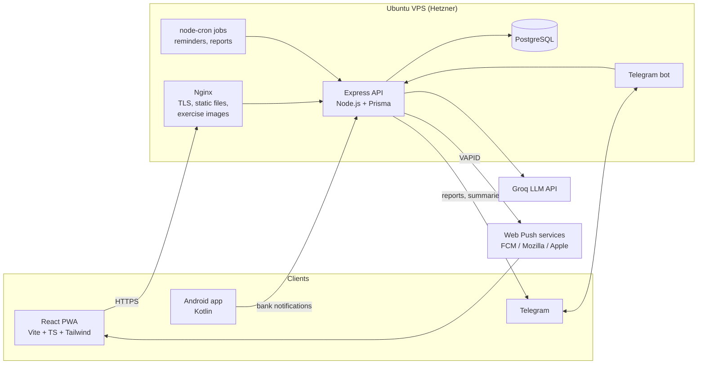

# Control de Gastos — Personal Finance, Fitness & Productivity

A full-stack personal life tracker in production at **[gastos.sebscode.dev](https://gastos.sebscode.dev)**: money, training, nutrition and habits in one place, with AI insights that work on top of deterministic calculations.

Built and operated end to end by [Juan Sebastián Villegas](https://linkedin.com/in/juansebastianv27): React frontend, Node.js API, PostgreSQL, a Telegram bot and an Android companion app, self-hosted on a Linux VPS.

> 🇪🇸 The app UI is in Spanish (built for Colombia, amounts in COP). This README is in English.

<!-- Replace with real screenshots: save them in docs/screenshots/ -->
| Dashboard | Debts & AI plan | Exercise catalog |
|---|---|---|
|  |  |  |

---

## Features

**Finance**
- Income and expense tracking with categories, budgets and alerts at 80% / 100%
- **Month-end spending forecast** per category, blending the current month's pace with a 3-month history (one-off expenses such as rent are not extrapolated daily)
- **Debts & loans** (what I owe and what I'm owed): payments create linked expense/income transactions; avalanche vs. snowball payoff simulation with EA or monthly interest rates
- **AI financial advice** (Groq LLM) that interprets the simulations and spending patterns, plus a weekly summary on Telegram
- **Monthly PDF report** (finance, budgets, debts, habits, training, AI commentary), generated server-side and delivered by Telegram on the 1st of each month
- Android companion app that reads push notifications from Colombian banks (Bancolombia, Nequi, Daviplata, BBVA, Davivienda) to log expenses automatically

**Fitness**
- Routine builder and live workout sessions with sets, RPE and rest timers taken from the routine
- Catalog of ~780 exercises with photos and step-by-step instructions, translated to Spanish with an LLM
- **Personal records** detected in real time (max weight, estimated 1RM with Epley, reps at a given weight) and a 1RM percentage calculator
- Meal logging with macros; a meal with a price automatically creates a linked expense

**Productivity**
- Habits with streaks computed from daily logs, a 6-month heatmap and completion by weekday
- Tasks, routines and pomodoro

**Platform**
- Installable PWA with **Web Push notifications** (budgets, habit reminders, upcoming debt payments, PRs, weekly summary) and per-type preferences
- Dark mode (light / dark / system)

---

## Architecture



---

## Technical decisions

**Deterministic math, AI only for interpretation.** Debt payoff simulations, spending forecasts, streaks and 1RM estimates are computed in code. The LLM receives the results and turns them into advice in plain language. Language models are unreliable at arithmetic; this keeps the numbers correct and the AI output easy to verify.

**Privacy before sending data to an LLM.** Only amounts, rates and category totals are sent to Groq. Debts are anonymized ("Credit card 1", "Personal loan 2"), so the names of people or banks never leave the server.

**Linked records instead of duplicated data.** A meal with a price or a debt payment creates a transaction linked by foreign key. Editing or deleting the source updates or removes the transaction, and budgets and alerts are recalculated.

**Timezone-aware by design.** Colombia is UTC−5 with no DST. Daily grouping, month boundaries, habit days and reminder times are computed in `America/Bogota`, which fixed charts placing evening expenses on the next day.

**Web Push without Firebase.** Notifications use the Web Push standard with self-generated VAPID keys (`web-push`). Expired subscriptions (404/410) are cleaned up automatically, and each notification type can be turned off.

**Lightweight PDF generation.** Reports are drawn with `pdfkit` instead of a headless browser, which keeps memory usage low on a 4 GB VPS.

**Open exercise data.** The exercise catalog comes from [free-exercise-db](https://github.com/yuhonas/free-exercise-db) (public domain, Unlicense), imported idempotently and served from the VPS. Original duplicated exercises were merged into the catalog without losing workout history.

---

## Tech stack

| Layer | Technologies |
|---|---|
| Frontend | React 18, TypeScript, Vite, Tailwind CSS, TanStack Query, Recharts, lucide-react |
| Backend | Node.js, Express, Prisma ORM, node-cron, web-push, pdfkit |
| Database | PostgreSQL |
| AI | Groq API (LLM) for advice, forecasts commentary, translations and food estimates |
| Mobile | Android (Kotlin), NotificationListenerService |
| Infra | Ubuntu VPS (Hetzner), Nginx, PM2, Let's Encrypt, daily `pg_dump` backups |
| Integrations | Telegram Bot API, Web Push (VAPID) |

---

## Project structure

```
.
├── backend/          # Express API
│   ├── prisma/       # Schema
│   ├── scripts/      # Data import, translation and maintenance scripts
│   └── src/
│       ├── controllers/
│       ├── routes/
│       └── services/ # Business logic: forecasts, debts, records, push, reports...
├── frontend/         # React PWA
│   ├── public/       # Service worker, manifest, icons
│   └── src/
├── android/          # Kotlin companion app
└── deploy.sh         # Build, sync and restart on the VPS
```

---

## Running locally

Requirements: Node.js 20+, PostgreSQL 15+.

```bash
# Backend
cd backend
cp .env.example .env        # fill in DATABASE_URL, JWT_SECRET, GROQ_API_KEY...
npm install
npx prisma db push
npm run dev

# Frontend (another terminal)
cd frontend
npm install
npm run dev
```

Optional variables: `TELEGRAM_TOKEN` (bot messages and reports), `VAPID_PUBLIC_KEY` / `VAPID_PRIVATE_KEY` / `VAPID_SUBJECT` (push notifications; generate them with `node scripts/generateVapid.js`).

## Deployment

```bash
./deploy.sh frontend         # type-check, build, rsync dist/ to Nginx
./deploy.sh backend          # syntax check, rsync, npm install, PM2 restart
./deploy.sh backend --db     # same + database backup and Prisma schema sync
./deploy.sh all
```

The script resolves paths from its own location, so it always syncs the right folders regardless of the current directory. Secrets (`.env*`) are never synced.

---

## Author

**Juan Sebastián Villegas** · Medellín, Colombia
[LinkedIn](https://linkedin.com/in/juansebastianv27) · [GitHub](https://github.com/sebasv27)
